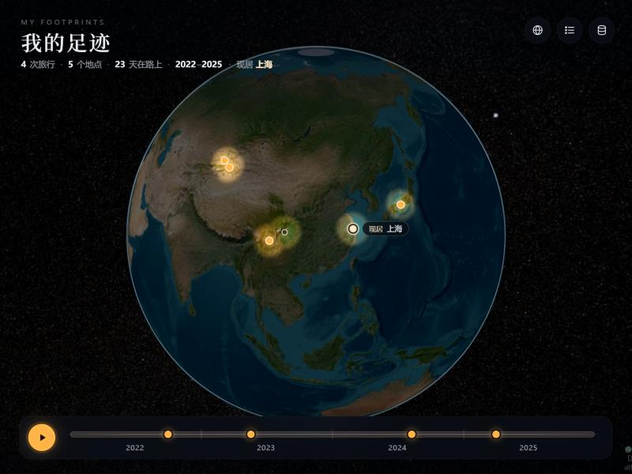

<div align="center">

# Oh My Trace

**把你走过的地方，点亮在 3D 地球上。**

A 3D night globe where the places you've been light up.

</div>



整个地球沉在夜色里，只有你去过的地方亮着真实的白天卫星地貌。点一下，镜头飞到那里，在真实的山川地形上空缓缓盘旋；再「近看」，就能看到那里的风景：随风摇摆的树林、扫过山坡的风和云影。


## 功能

- **夜色地球**：没去过的地方暗下来，但仍看得见大陆轮廓；去过的地方被点亮，边缘带一圈暖色光晕。
- **真实地形飞入**：卫星影像加真实海拔，每个山坡按朝向打上光影，远山带一层蓝色空气透视。飞到目的地后视角倾斜，缓慢环绕。
- **近看风景**：在旅行卡片里点地点旁的「近看」，镜头会降到离地约 4 公里。
  - **树长在哪里**：读取当地卫星影像，只在影像里真正是森林的地方种树。
  - **长什么树**：按地区和海拔选当地的标志植被，比如天山的雪岭云杉、东北的白桦和落叶松、江南的竹林和阔叶林、热带的棕榈、日本的樱花、落基山和阿尔卑斯的针叶林。
  - **什么季节**：按旅行日期决定，秋天变金黄，冬天落叶，春天樱花开放，夏天草甸上开满野花。
  - **动起来**：树木随风摇摆，阵风和云影从山坡上扫过。
- **旅行卡片**：日期、天数、途经地点和备注。同一行程的多个地点会合并为一次旅行，并用弧线连起来。
- **常驻地**：现居地和曾居地用不同标记显示。每次旅行会标出「从哪里出发」，时间轴上显示各段居住时期。
- **时间轴与回放**：可以按年份筛选。一键回放会从常驻地出发，按时间顺序飞过每一次旅行，飞到一处就点亮一处。
- **在网页里管理数据**：拖入或粘贴 CSV、在线编辑表格、导出带坐标的 CSV。Excel 导出的中文 CSV（GBK 编码）也能正确识别。
- **地点校正**：地名自动定位后可以确认；不准的话可以换个说法搜索，或者直接在地球上点选。
- **手机适配**：手机和低配设备上会自动减少树木数量。

## 快速开始

纯静态网页，不需要安装或构建，但需要联网加载地图。

Windows：

```powershell
powershell -ExecutionPolicy Bypass -File serve.ps1
```

然后打开 <http://localhost:8765>。

其他系统用任意静态文件服务器都行，例如：

```bash
python3 -m http.server 8765
```

第一次打开会显示一组虚构的示例足迹。点右上角的数据按钮导入你自己的 CSV，选「替换全部」即可。

### 本地性能调试

持续修改代码时建议用 `python3 serve.py` 启动开发服务，它会禁用浏览器缓存，确保刷新后使用最新的脚本模块；仍只监听本机的 8765 端口。

打开 `http://localhost:8765/?perf=1` 可显示本机的渲染帧率、帧间隔、长任务、渲染尺寸和植被数量；数据仅在浏览器内统计，不上传。

默认采用自适应画质：桌面目标 60 FPS，窄屏目标 30 FPS，持续掉帧时逐步降低渲染分辨率和地形细分。目标帧率不代表所有设备和地点都能达到。全球开场短暂旋转后静止，静止时按需渲染，并恢复到桌面最高 2 倍、窄屏最高 1.5 倍像素密度（不超过设备原生密度）；继续移动时返回动画画质预算。地点环绕、飞行、足迹点亮和旅行回放仍持续更新。切到后台会暂停渲染循环。

近景植被在 Web Worker 中识别；不支持 Worker 时分段计算，避免一次长时间占用主线程。加载并发限制为 4，离开地点时取消请求与后台任务。桌面最多 3000 棵树、300 组花草，窄屏及低核心设备最多 600 棵树、60 组花草；仅附近少量植被参与摇摆动画，静态与动态植被使用独立缓冲区。

代码仍可直接静态部署，新增的模块位于 `src/performance/`、`src/scenery/`、`src/rendering/`。运行性能相关逻辑检查：

```bash
node tests/performance.mjs
```

全球视角采用更明亮的卫星地表、蓝色边缘光、静态星空和日出光晕。全球云层来自 NASA Blue Marble 历史合成影像，使用独立的低面数椭球显示，放大后淡出；不是实时天气。素材来源见 [assets/SOURCES.md](assets/SOURCES.md)。Cesium 版本仍固定为 1.120.0，本轮没有同时升级引擎。

通透度调整会压掉云图的低密度灰底，保留较厚的云团；地表增加适度对比，蓝色散射集中到球体边缘，近景远山仍保留较淡的空气透视。全球明暗及云层使用同一相机方向的艺术光照，非真实日期的太阳模拟。

右上角月亮按钮或 `N` 键可在日间地球与原有足迹夜景之间切换。

## CSV 格式

| 列 | 必填 | 说明 |
|---|---|---|
| 日期 | 建议 | `2023-03-30~2023-04-04`、`2024-06`、`2025` 都可以；常驻地写居住时段，如 `2021-07~至今` |
| 行程 | 建议 | 同一日期、同一行程的多行会合并成一次旅行 |
| 地点 | 必填 | 尽量写「省份 + 地名」，如 `四川稻城亚丁`，自动定位更准 |
| 类型 | 可选 | `旅行`、`出差`、`徒步`……不同类型用不同颜色；填 `现居地` 或 `曾居地` 标为常驻地 |
| 备注 | 可选 | 显示在旅行卡片上 |
| 坐标 | 可选 | `"纬度,经度"`（带引号），填了就不再自动定位 |

表头也认英文：`date`、`trip`、`place`、`type`、`note`、`coord`，或者分开的 `lat` / `lon`。从 Excel 直接复制粘贴（制表符分隔）也可以。

示例：

```csv
日期,行程,地点,类型,备注,坐标
2021-07~至今,,上海,现居地,,
2015-09~2021-06,,四川成都,曾居地,,
2022-10-01~2022-10-06,川西秋色,四川稻城亚丁,旅行,雪山与彩林,
2024-08-10~2024-08-18,独库公路,新疆那拉提,旅行,空中草原,
2024-08-10~2024-08-18,独库公路,新疆赛里木湖,旅行,,
2025-04,京都赏樱,日本京都,旅行,,"35.0116,135.7681"
```

## 数据与隐私

- 你的数据只保存在自己浏览器的本地存储（localStorage）里，不会上传到任何服务器。
- 清除浏览器数据会把它一起清掉，记得用「导出当前数据」备份。换浏览器或换设备需要重新导入。
- 自动定位时，地名会发送给 OpenStreetMap 的 Nominatim 服务。

## 数据来源与致谢

- [CesiumJS](https://cesium.com/platform/cesiumjs/)（Apache-2.0）：3D 地球引擎
- [Esri World Imagery](https://www.arcgis.com/home/item.html?id=10df2279f9684e4a9f6a7f08febac2a9)：卫星影像，© Esri, Maxar, Earthstar Geographics
- [Esri World Elevation](https://www.arcgis.com/home/item.html?id=7029fb60158543ad845c7e1527af11e4)：地形高程
- [Nominatim](https://nominatim.org/)：地名定位，数据 © [OpenStreetMap](https://www.openstreetmap.org/copyright) contributors（ODbL）。公共服务限制约每秒 1 次请求，本项目已按此限速。
- [jsDelivr](https://www.jsdelivr.com/)：CDN

以上服务各有使用条款。如果要大规模或商业部署，请换成你自己的数据服务。

植被是根据卫星影像颜色和简化的地区规则推断的，是风格化的表现，不是真实的植被数据。如果某地的影像拍摄于落叶季或雪季，可能识别不出森林。

## 许可证

[MIT](LICENSE)
