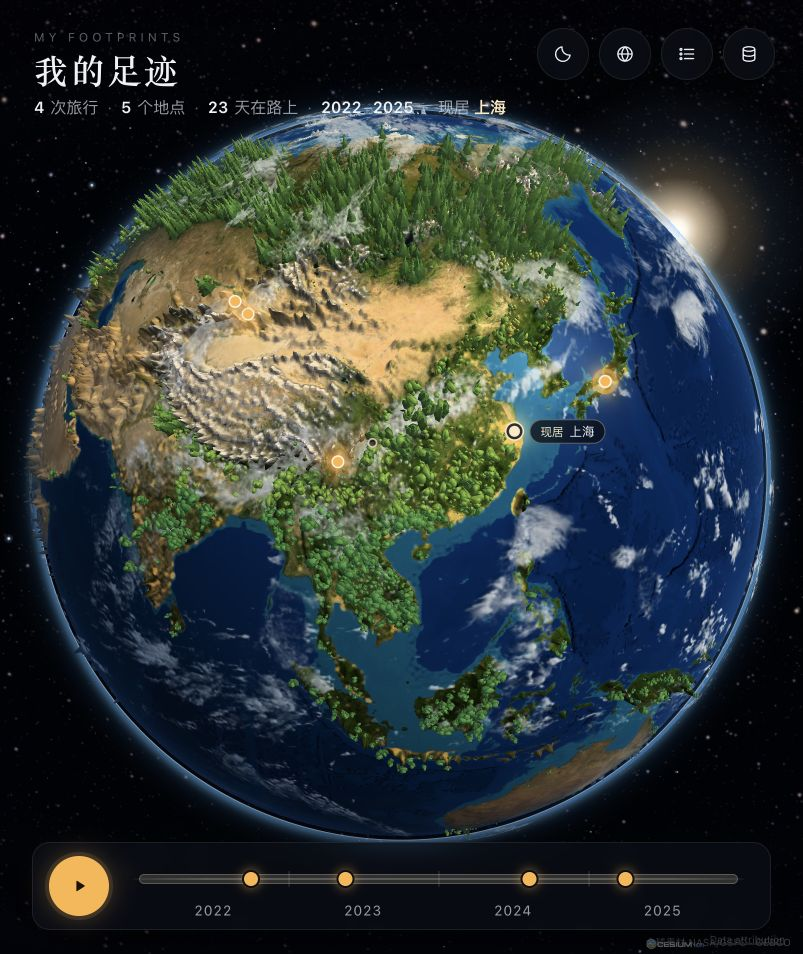
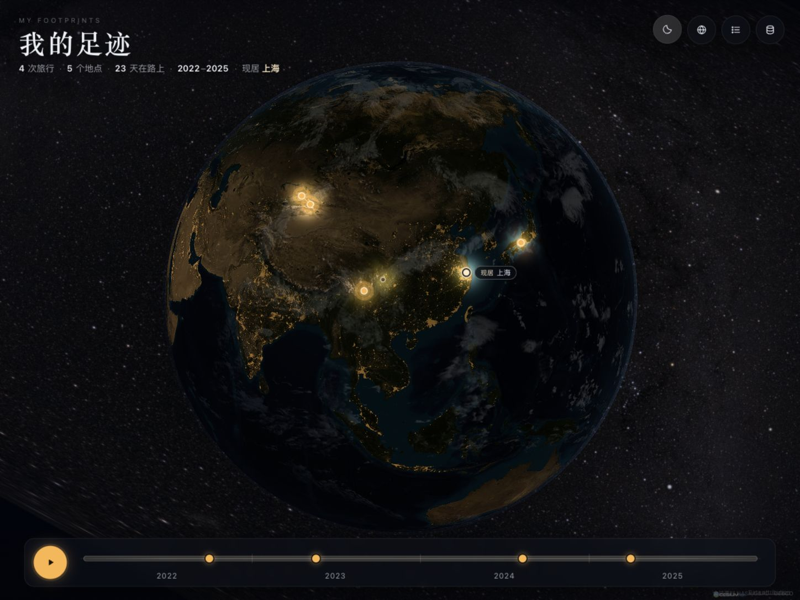
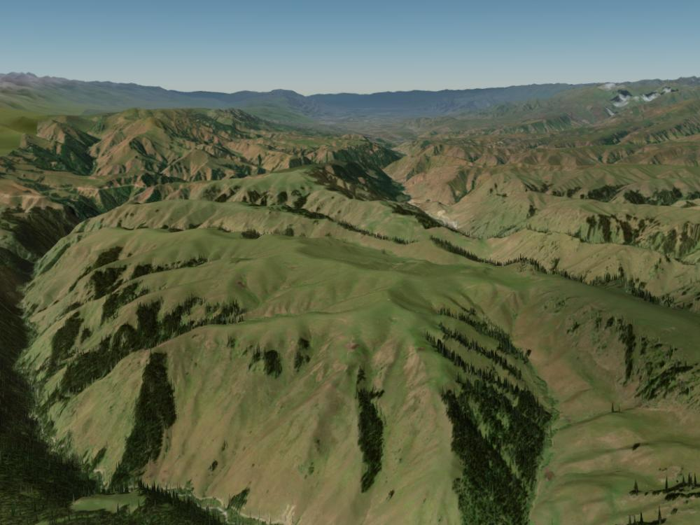

<div align="center">

# Oh My Trace

**把你走过的地方，点亮在 3D 地球上。**

A 3D night globe where the places you've been light up.

</div>

现已加入微缩地球：在 NASA 地理底图上生成夸张山脉、分层雪线和实例化 3D 森林，并保留海深配色、云影、城市灯光、薄层大气与银河背景。全球与近景共用 Cesium 相机及 WGS84 坐标，下降时衔接真实卫星影像和地形；仍可用右上角月亮按钮切换足迹夜景。



从全球足迹飞入旅行地点，在真实的山川地形上空盘旋；再「近看」，可以看到按地区与季节生成的植被和掠过山坡的云影。切换到足迹夜景后，城市灯光与去过的地方在暗色地表上亮起。





本轮 Scenic Earth 调整加入区域森林冠层、开阔草原规则、城市核心排除、树根与实际网格贴合，以及山脊、雪线和接触暗部。阔叶与热带树改用主枝冠层和不规则叶缘，并加入逐株形状与色彩变化；森林 LOD 等待新模型就绪后替换，全球与近景共用光照方向。保持单 Cesium 引擎、静态部署；实现细节与剩余视觉差距见 [微缩世界](docs/MICRO_WORLD.md) 和 [验证记录](docs/VALIDATION.md)。

当前优先把全球整体画面推向目标：地球构图更饱满，只有崎岖山地增加细分，雪岩分层更鲜明，海洋由深蓝过渡到蓝绿大陆架，森林受光偏暖、暗部偏冷，星空减少灰雾。保留真实经纬度与 DEM；近景尺度衔接与精细枝叶随后继续完善。

本次整体校准收窄浅海亮色带、保留更多高原裸岩，把积雪集中到更高的山峰与合适坡面，并加强树冠朝阳面和暗部的层次；地表网格与纹理采样数量保持原预算。

森林按地区形成低层冠层、成组高树和林间空地。宽大冠层适度压低并增加长短轴变化，山地树冠接近雪线时连续降低，让山脊露出；地形按相对地势增强，并保留高度上限，凸起峰顶补充窄雪帽。桌面实例和地表网格预算不变，手机档适度补密，并保留候选与常驻分块上限。 最新校准提高低层树冠体积，并收敛少量过高树尖；继续使用原树冠模型、根点和候选数量，让林海更连贯、山脊更易读。 山麓冠层再按覆盖范围内的 DEM 高差收紧，减少低地巨树横盖山脊；源影像支持的凸起雪峰补回窄雪帽，保留高原裸岩。

区域植被 LOD 保留为开发预览（`?regional=1`），默认关闭。它复用有数量上限的实例化三维 GLB，并使用真实地形采样；中景树冠已从细小点状改为可辨认的立体轮廓，下降时连续收缩至近景比例。完整地形与森林交接仍未通过视觉验收。日间地形在展示层交接区间转亮，足迹夜景保留原逻辑。

足迹较多时，邻近地点会显示为数字聚合点，点开可查看完整地点列表或放大展开。底部提供「全部」及各年份，地图、旅行列表、统计和夜景点亮同步筛选；密集时间轴按年、月汇总，选中旅行后显示路线。具体规则见 [足迹与年份显示](docs/FOOTPRINTS.md)。

当前为整体画面预览版。桌面固定视角实测约 60 FPS，手机画质平均约 30 FPS；选帧节拍已加入动画时钟抖动处理，修正前后的原始数据均保留。手机帧间隔仍有波动，尚未通过完整平滑度和真机验收，详见验证记录。

## 功能

- **全球日间地球**：独立地表、海洋、云和大气材质，共享光照方向；全球与真实地形使用同一套地理坐标和相机。
- **微缩世界**：全球展示使用 30 倍高程夸张、雪线、山脊明暗及谷地遮蔽。针叶、阔叶、白桦和热带树使用真正的 GLB 三维网格，全球树木为艺术化比例；不是把参考图作为背景。
- **夜色地球**：没去过的地方暗下来，但仍看得见大陆轮廓；去过的地方被点亮，边缘带一圈暖色光晕。
- **真实地形飞入**：卫星影像加真实海拔，每个山坡按朝向打上光影，远山带一层蓝色空气透视。飞到目的地后视角倾斜，缓慢环绕。
- **近看风景**：在旅行卡片里点地点旁的「近看」，镜头按场景以约 0.26–2.4 公里的观察距离低角度环绕；草原更低，雪山适当拉远。
  - **树长在哪里**：从当地卫星颜色推断森林，排除水色、屋顶、树线以上与陡壁；呼伦贝尔以草甸为主，那拉提保留山坡针叶林。
  - **地点模板**：山林、白桦薄雾、草原、高山雪谷、樱花、海岸城市，以及稀疏戈壁灌丛，分别配置树种、树线、密度、地面色调、雾与粒子。
  - **什么季节**：使用旅行月份；京都 3–5 月显示樱花及花瓣，其余月份使用阔叶树；白桦秋季转为金色，冬季有覆雪与飘雪。植被表达为风格化推断，不能代替当地物候资料。
  - **动起来**：GPU 顶点风摆、草浪、局部薄雾、雪、花瓣或萤火粒子，遵循系统的减少动态效果偏好。
- **旅行卡片**：日期、天数、途经地点和备注。同一行程的多个地点会合并为一次旅行，并用弧线连起来。
- **常驻地**：现居地和曾居地用不同标记显示。每次旅行会标出「从哪里出发」，时间轴上显示各段居住时期。
- **年份与回放**：可选择全部或指定年份，跨年旅行会计入重叠年份。大数据时间轴按年/月汇总，点开月份可选择旅行；回放遵循当前年份筛选，按时间顺序飞过每次旅行。
- **在网页里管理数据**：拖入或粘贴 CSV、在线编辑表格、导出带坐标的 CSV。Excel 导出的中文 CSV（GBK 编码）也能正确识别。
- **地点校正**：地名自动定位后可以确认；不准的话可以换个说法搜索，或者直接在地球上点选。
- **手机适配**：手机和低配设备上会自动减少树木数量。

## 快速开始

纯静态网页，不需要安装前端依赖或构建。CesiumJS 1.120.0 和全球展示素材已随项目提供；真实地点的卫星瓦片、地形及地名搜索需要联网。

macOS 可双击 `start.command`（需本机已有 Python 3），它会启动服务并打开浏览器。也可在终端运行：

```bash
python3 serve.py --open
```

Windows：

```powershell
powershell -ExecutionPolicy Bypass -File serve.ps1
```

然后打开 <http://localhost:8765>。

其他系统用任意静态文件服务器都行，例如：

```bash
python3 -m http.server 8765
```

第一次打开会显示一组虚构的示例足迹。点右上角的数据按钮导入你自己的 CSV，选「替换全部」即可。

### 本地性能调试

持续修改代码时建议用 `python3 serve.py` 启动开发服务，它会禁用浏览器缓存，确保刷新后使用最新的脚本模块；仍只监听本机的 8765 端口。

打开 `http://localhost:8765/?perf=1` 可显示本机的渲染帧率、帧间隔、长任务、渲染尺寸和植被数量；数据仅在浏览器内统计，不上传。

默认采用自适应画质：桌面目标 60 FPS，窄屏目标 30 FPS，持续掉帧时逐步降低渲染分辨率和地形细分。目标帧率不代表所有设备和地点都能达到。全球开场短暂旋转后静止，静止时按需渲染，并恢复到桌面最高 2 倍、窄屏最高 1.5 倍像素密度（不超过设备原生密度）；继续移动时返回动画画质预算。地点环绕、飞行、足迹点亮和旅行回放仍持续更新。切到后台会暂停渲染循环。

近景植被在 Web Worker 中识别；不支持 Worker 时分段计算。影像加载并发限制为 4，模型限制为 2，离开地点时取消请求与后台任务。桌面最多 3000 个树木候选、草原最多 1200 组草丛；受限设备分别为 600 和 250，实际数量再乘模板密度并受海拔规则过滤。网格通过 `EXT_mesh_gpu_instancing` 批量绘制，桌面在 2.8 公里分界切换近远模型，9 公里外裁剪；手机仅加载低细节模型。全球森林按地理分块懒加载，背面回收，进入近景后释放。持续动画期间停用覆盖层的背景模糊。

代码仍可直接静态部署，新增的模块位于 `src/performance/`、`src/scenery/`、`src/rendering/`。运行性能相关逻辑检查：

```bash
npm test
```

低空高度查询使用有界地形空间索引，保留原始网格与 Cesium 三角形求交，避免每帧遍历整块高密度地形。仅对固定的 1.120 版本和已验证的高度图网格启用，其余情况回退原引擎。白天近景使用独立材质，云影与风向在 CPU 端转换一次坐标；夜景和飞行过渡继续平滑混合。具体精度、缓存预算和实测限制见验证记录。

全球视角由 `src/rendering/hero-earth.js` 调度独立地表、云和大气球壳，`earth-materials.js` 实现地表与海洋材质、地形明暗、海面反光、云影和夜间灯光。首屏使用 2048 像素贴图，再异步升级地表：桌面保留 5400 像素原图，触屏或内存受限设备上限 4096，已知内存不超过 2 GB 的设备保留 2048；所有档位受实际 GPU 纹理上限约束。高度、海深与夜光保留 2048，把显存优先分配给地表。设备能力不再由窗口宽度推断，桌面窄预览面板也能恢复 Retina 静止画质；高分辨率静止画面关闭会软化细节的 FXAA。所有图层按世界位置计算经纬度，共用光源方向；太阳光晕放在 WebGL 画面后方，由地球自然遮挡。大气只绘制正面，避免背面半透明叠加覆盖地表。

全球纹理及云层为 NASA 历史合成数据，分别来自不同时间，不是实时天气或旅行日期对应的实况。素材来源与校验哈希见 [assets/SOURCES.md](assets/SOURCES.md) 和 `assets/earth/manifest.json`。Cesium 仍固定为 1.120.0，官方浏览器构建及许可文件保存在 `vendor/cesium/`。

高于约 4300 公里的视角会停止绘制底层地形；下降后预加载地形，约 2400–650 公里之间淡出展示材质，再进入真实地形。材质资源加载失败时保留原卫星地球。全局展示与近景均保留足迹、年份筛选、回放和坐标校正。

通透度调整会压掉云图的低密度灰底，保留较厚的云团；地表增加适度对比，蓝色散射集中到球体边缘，近景远山仍保留较淡的空气透视。全球明暗及云层使用同一相机方向的艺术光照，非真实日期的太阳模拟。

微缩世界的模块与配置见 [docs/MICRO_WORLD.md](docs/MICRO_WORLD.md)，实际测试与性能边界见 [docs/VALIDATION.md](docs/VALIDATION.md)。原始三维资产可用 `node scripts/build-vegetation-assets.mjs` 重新生成，不依赖建模软件或外部资产服务。

本地景观演示：在地址后加 `?demo=birch_forest`（白桦）、`?demo=grassland`（草原）、`?demo=mountain_forest`（山林）、`?demo=alpine_snow`（雪山）、`?demo=sakura`（樱花）、`?demo=coastal_city`（城市）或 `?demo=desert`（戈壁）。点时间轴行程，再点「近看」。可加 `&month=10` 检查白桦秋色。演示采用虚构足迹，只在内存中运行，返回首页仍使用原有本地数据。`&perf=1` 打开可折叠性能摘要，`&profile=1` 额外开启开发 CPU 计时；不发送遥测。

右上角月亮按钮或 `N` 键可在日间地球与原有足迹夜景之间切换。

## CSV 格式

| 列 | 必填 | 说明 |
|---|---|---|
| 日期 | 建议 | `2023-03-30~2023-04-04`、`2024-06`、`2025` 都可以；常驻地写居住时段，如 `2021-07~至今` |
| 行程 | 建议 | 同一日期、同一行程的多行会合并成一次旅行 |
| 地点 | 必填 | 尽量写「省份 + 地名」，如 `四川稻城亚丁`，自动定位更准 |
| 类型 | 可选 | `旅行`、`出差`、`徒步`……不同类型用不同颜色；填 `现居地` 或 `曾居地` 标为常驻地 |
| 备注 | 可选 | 显示在旅行卡片上 |
| 坐标 | 可选 | `"纬度,经度"`（带引号），填了就不再自动定位 |

表头也认英文：`date`、`trip`、`place`、`type`、`note`、`coord`，或者分开的 `lat` / `lon`。从 Excel 直接复制粘贴（制表符分隔）也可以。

示例：

```csv
日期,行程,地点,类型,备注,坐标
2021-07~至今,,上海,现居地,,
2015-09~2021-06,,四川成都,曾居地,,
2022-10-01~2022-10-06,川西秋色,四川稻城亚丁,旅行,雪山与彩林,
2024-08-10~2024-08-18,独库公路,新疆那拉提,旅行,空中草原,
2024-08-10~2024-08-18,独库公路,新疆赛里木湖,旅行,,
2025-04,京都赏樱,日本京都,旅行,,"35.0116,135.7681"
```

## 数据与隐私

- 你的数据只保存在自己浏览器的本地存储（localStorage）里，不会上传到任何服务器。
- 清除浏览器数据会把它一起清掉，记得用「导出当前数据」备份。换浏览器或换设备需要重新导入。
- 自动定位时，地名会发送给 OpenStreetMap 的 Nominatim 服务。

## 数据来源与致谢

- [CesiumJS](https://cesium.com/platform/cesiumjs/)（Apache-2.0）：3D 地球引擎
- [Esri World Imagery](https://www.arcgis.com/home/item.html?id=10df2279f9684e4a9f6a7f08febac2a9)：卫星影像，© Esri, Maxar, Earthstar Geographics
- [Esri World Elevation](https://www.arcgis.com/home/item.html?id=7029fb60158543ad845c7e1527af11e4)：地形高程
- [Nominatim](https://nominatim.org/)：地名定位，数据 © [OpenStreetMap](https://www.openstreetmap.org/copyright) contributors（ODbL）。公共服务限制约每秒 1 次请求，本项目已按此限速。
- [jsDelivr](https://www.jsdelivr.com/)：CDN

以上服务各有使用条款。如果要大规模或商业部署，请换成你自己的数据服务。

植被是根据卫星影像颜色和简化的地区规则推断的，是风格化的表现，不是真实的植被数据。如果某地的影像拍摄于落叶季或雪季，可能识别不出森林。

## 许可证

[MIT](LICENSE)
