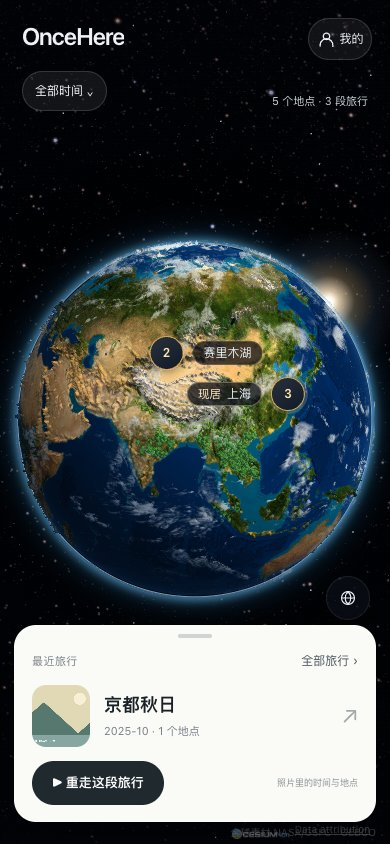
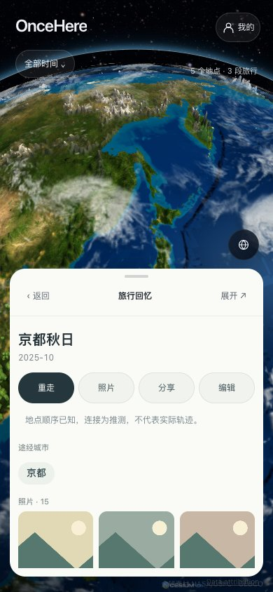
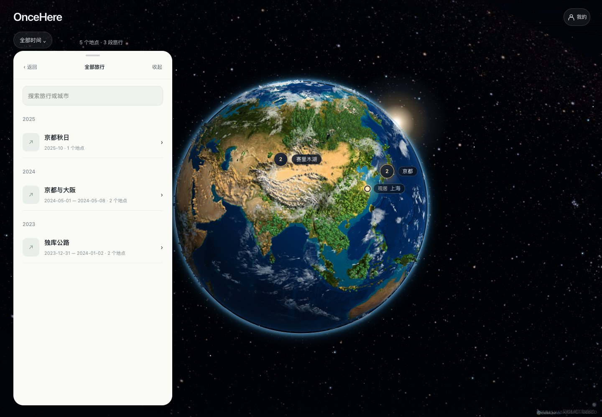

# 地球首页产品实验

2026-10-29。基线 `main@a5fa342`，实验分支 `experiment/earth-home`。不合入 main，未引入另一 session 的 I3/I4 工作。

## 预览

在本分支目录运行 `python3 serve.py --port 8877`，打开
[地球首页实验](http://127.0.0.1:8877/?preview=earth-home)。
首次使用该浏览器配置时，这个地址展示内存中的虚构足迹，不写入个人记录。
已有个人记录时继续使用已有数据。普通 `/` 从空地球开始，可以选择虚构示例或添加照片。
内置 CSV 示例没有相册照片；下方验收截图使用额外的虚构记录和程序绘制缩略图，
这些夹具只由浏览器验收脚本注入，不进入用户数据库。

## 本轮交付

| 目标 | 实现与证据 |
|---|---|
| 地球唯一首页、单张旅行摘要 | `src/ui/earth-home.js`、`earth-home.css`；手机底卡，桌面左下摘要；没有卡片信息流 |
| 全貌开场、按发生时间找最近旅行 | 默认不选中旅行；`recentTrips` 按记录时间排序，未知日期排末尾；补录不改发生日期 |
| 摘要／半展开／完整内容 | 同一底部容器承接目录、城市、旅行、照片和编辑；支持点击、手柄拖动和 Escape 返回 |
| 旅行目录与城市到访 | 按年目录、目录内搜索；实际点击地图聚合点可在同一内容层选城市，再进入相关旅行 |
| 一个时间入口 | 全部／年份／已有阶段；目录、地球、统计和照片共同筛选；跨年停靠点按当前范围投影，回放与分享继续携带年份／阶段限制 |
| 标题与重复地点 | 自动标题缩短、人工标题原样保留；有一致行政身份的别名共用地图城市身份，详情汇集关联记录；同名异地不按名字合并 |
| 主动回放与返回 | 导入和启动不自动回放；回放退出恢复镜头、实体选择、筛选和照片页面；暂停、继续、进度与退出沿用原播放器 |
| 管理入口 | 首页保留“我的”；照片导入、确认居住、备份恢复、显示和高级编辑仍可访问；分享与编辑进入详情后出现 |

照片详情优先展示本地可用缩略图，点击后在同一内容层放大预览。
日期仍保留年／月／日／未知精度。未经可靠行政解析的 CSV 地点使用“个地点”，
不把景点或未知位置伪装成城市数量。

同城投影归一不改写原始地点、照片或到访 ID，不移除真实折返与多次到访。
同城多次到访由城市详情中的相关旅行进入；地点全称不再拼满自动旅行标题。
分享仍默认模糊位置、不含照片和备注，保留原有审查流程。

## 验证

- `npm test`：渲染／性能逻辑检查与 **235 项 Life 测试**通过，其中新增 7 项排序、城市身份、跨年范围与阶段范围回归。
- `npm run test:production`：3 项构建可复现性、边界与 Android 名称检查通过。
- `npm run test:publishing`：6 项发布协议检查通过。
- `npm run build`：Editor、Viewer、Native Web 资源构建通过。
- `tests/life/earth-home-browser.mjs`：真实 Chrome 156，390×844、320×568、1440×1000；覆盖目录搜索／返回、真实地图点击、照片预览、年份与阶段、改名／拆分撤销、实际手柄拖动、分享范围、回放后的照片页与滚动恢复及“我的”管理入口；页面脚本错误 0。结果见 `earth-home/browser-verification.json`。
- 同一浏览器脚本还直接运行于 `dist/editor`，结果见 `earth-home/production-browser-verification.json`。
- 独立 Viewer 另用原有移动端脚本验证，结果见 `earth-home/viewer-verification.json`；不以私人编辑器测试代替 Viewer 的存储隔离验收。

固定视角前后比较，基线 `a5fa342`：

| 场景 | 中位 FPS：之前 → 之后 | P95 帧间隔：之前 → 之后 |
|---|---|---|
| 全球 | 60 → 60 | 19.1 → 19.2 ms |
| 高山 | 60 → 60 | 19.5 → 19.3 ms |

原始窗口保存在 `earth-home/performance.json`。协议：桌面 Chrome / SwiftShader、
1280×720，相同固定视角，预热 8 秒后六个两秒窗口；两个版本顺序运行。
该结果不能证明 Android 真机帧率，也不能证明飞行过程或冷瓦片加载完全平滑。

## 评审截图

手机首页：

手机旅行详情：

桌面旅行目录：

## 首次使用闭环（2026-10-29，分支 `claude/earth-home-polish`）

按 PRODUCT「首次使用」与白皮书 §2.2、§5.1，在地球首页内走完一次，不离开地球：

| 步骤 | 实现 |
|---|---|
| 权限前说明 | 首次导入页在按钮前说明"原图不上传"和"读取拍摄位置用于把照片放到城市上，不持续定位、不上传位置"；Android 系统权限弹窗在点击后才出现 |
| 扫描中点亮 | 读取照片时导入框收成底部条，地球上按约 0.25° 网格逐个亮起预览点（`src/life/media/scan-preview.js`）；预览点不写入记录，取消扫描不留下半份数据；提交后由正式标记接替 |
| 揭晓 | 底部内容层显示城市、旅行、国家 / 地区数，并如实说明"来自 N 张带位置的照片，另有 M 张没有位置" |
| 约 20 秒回放 | 仅在第一次自动导入后自动播放一次（减少动态效果时不自动播放）；之后的导入不自动回放 |
| 最多 3 问 | 复用 `FirstUseService`；可确认、改类型、跳过、撤销；刷新后从中断的问题继续 |
| 去向 | 多段居住 → 阶段草稿列表，点一项进入起名；居住不足一段且有旅行 → "生成某年年度回顾"；否则回到地球 |

验证：`tests/life/first-use-browser.mjs` 已改为地球首页流程（入口、位置说明、扫描中预览点、揭晓、问答、刷新续答、起名、重新整理不重复、自动回放与暂停），真实 Chromium 390×844 通过；`npm test` 237 项通过。
未测：Android 真机上的系统权限顺序、MediaStore 分页时的预览点、真实相册规模下预览点的绘制频率（上限每秒 4 帧）。

## 明确的后续工作

- 渐进点亮、分批提交／续扫以及浏览中持续导入，仍需要独立的数据一致性设计；本轮沿用现有导入能力。
- 不新增按照片移动归属、单城市按日期拆分或自动修复历史错误归并的算法；已有改名、合并、多站拆分、隐藏和撤销继续可用。
- 行政身份未知、边界漂移或已被旧算法错误合并的数据，不以名字／距离猜测自动修复；需要保留证据再纠错。
- 完整人生色带时间轴、海报、短视频、云同步与 AI 不在本实验范围。
- 放大照片目前复用脱敏缩略图，不增加原图读取通道。
- 真机权限、系统返回键、真实相册、Android SAF、两设备恢复与国产机型帧率尚未验证。

## 与 I3/I4 的整合边界

新导航与展示模型放在 `src/ui/earth-home*`，`app.js` 只接现有数据、镜头与回放。
`record-card.js` 的紧凑展示为可选参数；城市投影归一和 Story 范围修复属于共用模块，
未来整合时需保留其回归用例。与另一分支重叠的 `app.js` 连接点应按最终接口逐项合并，
不能用其中一个文件整体覆盖另一个。
